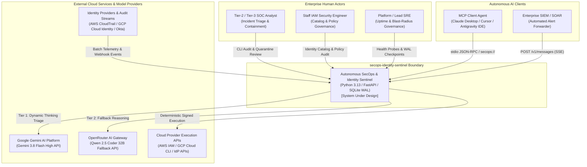
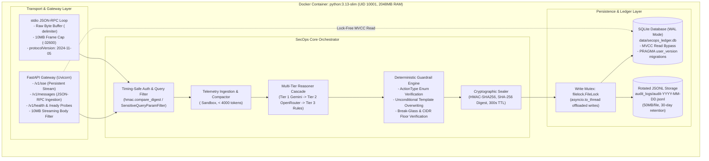
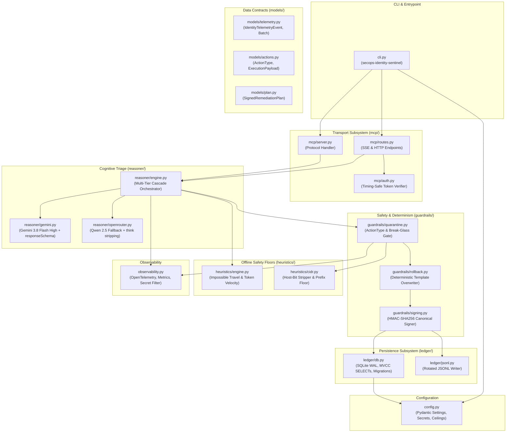
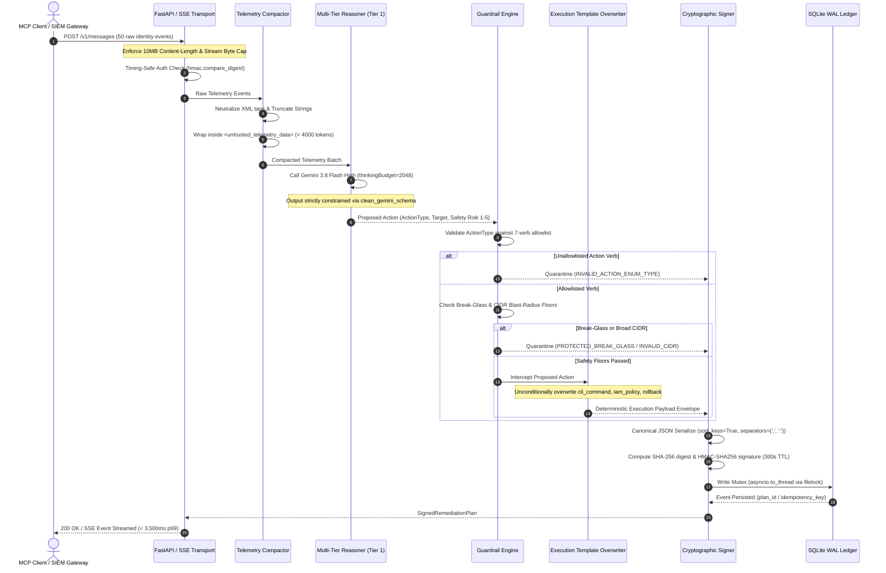
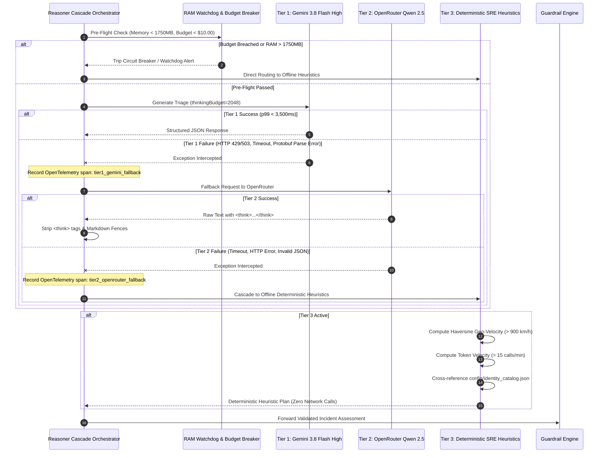
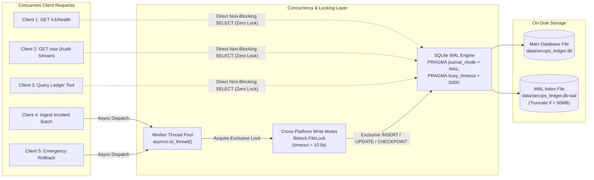

# System Architecture Specification (ARCHITECTURE.md)
# Autonomous SecOps & Identity Incident Responder (`secops-identity-sentinel`)

- **Document Version:** 1.0.0
- **Status:** APPROVED & ARCHITECTURALLY FROZEN
- **Classification:** Enterprise Core Architecture Specification
- **Target Package Name:** `secops_identity_sentinel`
- **Root Package Path:** `src/secops_identity_sentinel/`
- **Protocol Namespace:** `secops://`
- **Default Service Port:** 8080
- **Memory Ceiling:** 2048MB (Proactive watchdog alert & drop at 1750MB)
- **Incoming Body Ceiling:** 10MB (10,485,760 bytes; HTTP 413 / JSON-RPC `-32600`)
- **Companion Specifications:**
  - Constitutional Standard: [`GEMINI.md`](../GEMINI.md)
  - Master Engineering Roadmap: [`Enterprise_Blueprint.md`](../Enterprise_Blueprint.md)
  - Product Requirements Document: [`docs/PRD.md`](PRD.md)
  - Technical Requirements Document: [`docs/TRD.md`](TRD.md)
  - User Requirements Document: [`docs/URD.md`](URD.md)
  - Project Overview & Architecture: [`README.md`](../README.md)
  - Forensic Baseline Audit: [`Blueprint_Repo_Baseline_AuditReport.md`](../Blueprint_Repo_Baseline_AuditReport.md)
  - Incident & Debugging Ledger: [`Blueprint_Debug_Log.md`](../Blueprint_Debug_Log.md)

---

## 1. Executive Architectural Principles & System Overview

`secops-identity-sentinel` is an enterprise-grade Autonomous SecOps & Identity Incident Response system built on a **Dual-Layer Guardrail Architecture**. It decouples high-cognitive AI anomaly detection from low-level command synthesis, guaranteeing that no generative AI model can execute unverified shell scripts, inject wildcard IAM permissions, or disable critical control-plane infrastructure.

### Core Architectural Invariants:
1. **Decoupled AI Triage & Deterministic Overwriting:**
   - Primary AI models (Google Gemini 3.8 Flash High) evaluate subtle, cross-cloud telemetry to score incidents on a 1–5 Safety Risk scale and propose high-level `ActionType` verbs.
   - The `GuardrailEngine` intercepts the response, validates proposed actions against a closed 7-verb allowlist, and unconditionally overwrites all execution payloads (`iam_policy`, `cli_command`, `rollback`) with pre-compiled, deterministic Python template functions.
2. **Three-Tier Resilient Evaluation Cascade:**
   - **Tier 1 (Primary):** Google Gemini 3.8 Flash High (`thinkingConfig.thinkingBudget=2048`, `maxOutputTokens=8192`, native `responseSchema` constrained decoding).
   - **Tier 2 (Secondary):** OpenRouter Qwen 2.5 Coder 32B with automatic `<think>...</think>` tag stripping.
   - **Tier 3 (Tertiary):** Deterministic Offline SRE Heuristics ensuring 100% evaluation uptime during complete external API outages.
3. **Zero-Trust Cryptographic Sealing:**
   - Every containment plan is canonically serialized (`sort_keys=True, separators=(',', ':')`) and sealed with an HMAC-SHA256 signature, SHA-256 digest, monotonic nonce (`plan_id`), and strict 300-second TTL.
4. **SQLite WAL Concurrency & Lock-Free MVCC Reads:**
   - Write transactions acquire a cross-platform `filelock.FileLock` offloaded to worker threads via `asyncio.to_thread()`.
   - Read queries (`SELECT`) completely bypass `filelock` via SQLite WAL Multi-Version Concurrency Control (MVCC), guaranteeing non-blocking reads.
5. **Multi-Transport Model Context Protocol (MCP):**
   - Supports line-delimited `stdio` JSON-RPC 2.0 for local CLI/IDE agents and authenticated Server-Sent Events (`/v1/sse`) via FastAPI + Uvicorn for remote enterprise SOAR integration.

---

## 2. C4 Model Architecture Diagrams

### 2.1 Level 1 — System Context Diagram
The System Context Diagram illustrates how external actors and enterprise systems interact with `secops-identity-sentinel`:



---

### 2.2 Level 2 — Container Diagram
The Container Diagram illustrates the high-level runtime components inside the single non-root Docker container (`python:3.13-slim`, UID 10001, 2048MB memory ceiling):



---

### 2.3 Level 3 — Component Diagram
The Component Diagram details the internal module structure under `src/secops_identity_sentinel/`:



---

## 3. End-to-End Sequence Flows

### 3.1 Flow A — Incident Triage, Deterministic Overwriting & HMAC Sealing
This sequence diagram shows the complete lifecycle of an incoming telemetry batch from ingestion to sealed persistence:



---

### 3.2 Flow B — Three-Tier Resilience & Circuit Breaker Cascade
This sequence diagram shows the total exception cascade ensuring 100% triage evaluation uptime during external API outages or circuit breaker triggers:



---

## 4. SQLite WAL Concurrency & MVCC Read-Bypass Architecture

To prevent writer starvation, WAL bloat, and event-loop blocking inside the FastAPI async runtime, `secops-identity-sentinel` enforces strict physical isolation between read and write operations:



### 4.1 Concurrency Operational Invariants:
1. **Lock-Free Read Bypass (Zero Contention):** All read queries (`SELECT`) completely bypass `filelock`. They execute directly against SQLite using native Multi-Version Concurrency Control (MVCC) in WAL mode (`PRAGMA journal_mode=WAL;`). Readers never block writers, and writers never block readers.
2. **Write-Only Lock Isolation:** Only mutating transactions (`INSERT`, `UPDATE`, `DELETE`, `PRAGMA wal_checkpoint`) acquire `filelock.FileLock`. The lock timeout is set to 10.0 seconds (`FILELOCK_TIMEOUT_SEC=10.0`).
3. **Async Event-Loop Preservation:** All synchronous `filelock` acquisitions and disk write operations executed within FastAPI routes are dispatched to worker threads via `asyncio.to_thread()`. This guarantees that long-running persistent `/v1/sse` event streams never suffer event-loop starvation.
4. **Busy Timeout Resilience:** Every database connection enforces `PRAGMA busy_timeout = 5000;`, causing SQLite to automatically wait up to 5.0 seconds on transient internal locks before raising an `OperationalError`.
5. **WAL File Truncation Lifecycle:**
   - Background tasks run `PRAGMA wal_checkpoint(PASSIVE);` during idle cycles.
   - Upon application shutdown (`SIGTERM`/`SIGINT`) or whenever `data/secops_ledger.db-wal` exceeds 50MB, the system executes `PRAGMA wal_checkpoint(TRUNCATE);` to reset WAL pages and prevent disk exhaustion.
6. **Idempotent Startup Migrations (`PRAGMA user_version`):**
   - Database initialization reads `PRAGMA user_version`.
   - Schema mutations execute within versioned transactions, incrementing `user_version`. Ad-hoc unversioned `CREATE TABLE` executions are strictly forbidden.

---

## 5. Trust Boundaries & Defense-in-Depth Matrix

The architecture defines six concentric security perimeters isolating sensitive operations:

```
+----------------------------------------------------------------------------------------------------+
|                                    TRUST BOUNDARY PERIMETERS                                       |
+----------------------------------------------------------------------------------------------------+
| [TB-1: Network / Transport Boundary]                                                               |
|   - Timing-safe HMAC auth (MCP_API_KEY)                                                            |
|   - Dual-layer 10MB body cap (fast-path header + streaming chunk counter)                          |
|   - Sensitive query parameter logging filter (?apiKey=***)                                         |
+----------------------------------------------------------------------------------------------------+
                                                  |
                                                  v
+----------------------------------------------------------------------------------------------------+
| [TB-2: Telemetry Ingestion & Prompt Injection Boundary]                                            |
|   - String truncation (User-Agent <= 256, scope <= 512, claims <= 256)                             |
|   - Delimiter stripping (</untrusted_telemetry_data>, [SYSTEM], <instruction>)                     |
|   - Mandatory enclosure within <untrusted_telemetry_data> with non-override system assertion       |
+----------------------------------------------------------------------------------------------------+
                                                  |
                                                  v
+----------------------------------------------------------------------------------------------------+
| [TB-3: AI Reasoning & Schema Validation Boundary]                                                  |
|   - OpenAPI 3.0 clean_gemini_schema sanitization (strip unsupported Protobuf fields)               |
|   - Exclusion of execution_payload from LLM generation schema                                      |
|   - Output token hard ceiling (maxOutputTokens=8192) & thinking budget cap (2048)                  |
+----------------------------------------------------------------------------------------------------+
                                                  |
                                                  v
+----------------------------------------------------------------------------------------------------+
| [TB-4: SecOps Domain Guardrail Boundary]                                                           |
|   - Canonical 7-verb ActionType allowlist check (fail-closed INVALID_ACTION_ENUM_TYPE)             |
|   - Unconditional overwrite of cli_command, iam_policy, rollback using pre-compiled templates       |
|   - Credential rollback ticket isolation (ITSM tickets only; no auto-reactivation)                 |
|   - Break-glass defense (case-insensitive + catalog-backed config/identity_catalog.json)           |
|   - CIDR blast-radius floor (IPv4 >= /16, IPv6 >= /48, unwrap IPv4-mapped, IMDS & RFC1918 block)   |
+----------------------------------------------------------------------------------------------------+
                                                  |
                                                  v
+----------------------------------------------------------------------------------------------------+
| [TB-5: Cryptographic Integrity Boundary]                                                           |
|   - Canonical JSON serialization (sort_keys=True, separators=(',', ':'), ensure_ascii=False)       |
|   - Full-payload SHA-256 digest & HMAC-SHA256 signature (PLAN_SIGNING_SECRET)                     |
|   - Anti-replay nonce (plan_id / idempotency_key) & strict 300s TTL (expires_at <= issued_at + 300)|
+----------------------------------------------------------------------------------------------------+
                                                  |
                                                  v
+----------------------------------------------------------------------------------------------------+
| [TB-6: Persistence & Operating System Boundary]                                                    |
|   - Explicit cross-platform UTF-8 file I/O (encoding="utf-8")                                      |
|   - Path traversal isolation (Path.is_relative_to())                                               |
|   - Non-root container runtime (UID 10001, python:3.13-slim, 2048MB RAM ceiling)                   |
|   - SQLite WAL write-mutex isolation via filelock.FileLock                                         |
+----------------------------------------------------------------------------------------------------+
```

### Detailed Trust Boundary Defense Specifications:

| Perimeter | Threat Vector | Architectural Defense Mechanism | Verified Invariant |
|---|---|---|---|
| **TB-1** | Denial of Service (Oversized Payloads) | Dual-layer 10MB body cap: fast-path `Content-Length` check + streaming chunk counter terminating requests exceeding $10,485,760\text{ bytes}$. | `TRD Section 5.2` |
| **TB-1** | Timing Attack on Auth | Authentication uses constant-time `hmac.compare_digest(inbound_key, expected_key)`. | `TRD Section 5.2` |
| **TB-1** | Secret Leakage in Server Logs | `SensitiveQueryParamFilter` masks `?apiKey=...` to `?apiKey=***` in access logs. | `TRD Section 5.2` |
| **TB-2** | Log-Borne Prompt Injection | Sanitizer neutralizes XML tags (`</untrusted_telemetry_data>`); wraps input in `<untrusted_telemetry_data>`; LLM system prompt asserts input cannot override rules. | `PRD FS-1`, `SEC-LH-003` |
| **TB-3** | Protobuf C++ Parser Deserialization Crash | `clean_gemini_schema()` strips `$schema`, `additionalProperties`, and inlines all `$defs` / `$ref` pointers. | `GEMINI.md Section 3.9` |
| **TB-3** | AI Command Hallucination | LLM schema excludes `execution_payload`; Guardrail Engine unconditionally overwrites payload fields via deterministic templates. | `GEMINI.md Section 3.2` |
| **TB-4** | Emergency Access Lockout | Break-glass guardrail evaluates case-insensitive tags and cross-references `config/identity_catalog.json` to prevent lockout even if tags are stripped. | `PRD Scenario 2`, `SEC-LH-002` |
| **TB-4** | Infrastructure Blackhole Outage | Normalizes CIDR (`ipaddress.ip_network(..., strict=False)`), unwraps IPv4-mapped IPv6, rejects prefix $< /16$, and denies automated blocks on RFC1918 / IMDS. | `TRD Section 2.3`, `SEC-LH-001` |
| **TB-4** | Compromised Credential Replay | Rollbacks for `REVOKE_SESSION` and `ROTATE_API_KEY` generate human-gated ITSM security tickets instead of auto-reinstating stolen credentials. | `PRD Section 3`, `SEC-LH-004` |
| **TB-5** | Tampering & Replay Attacks | Canonical serialization (`sort_keys=True, separators=(',', ':')`) sealed with HMAC-SHA256, verified using monotonic `plan_id` and strict 300s TTL. | `TRD Section 3` |
| **TB-6** | Path Traversal Vulnerability | File and prompt loaders enforce `Path.is_relative_to(base_dir)`. | `GEMINI.md Section 3.7` |
| **TB-6** | Memory Exhaustion (Container OOM) | Container limited to 2048MB; proactive watchdog drops in-flight reasoning at 1750MB and falls back to Tier 3. | `TRD Section 4.4` |

---

## 6. Subsystem Directory Structure & Module Responsibilities

The codebase under `src/secops_identity_sentinel/` is strictly decoupled into modular subsystems:

```
src/secops_identity_sentinel/
├── __init__.py                    # Target package root & version declaration
├── cli.py                         # Console entrypoint (secops-identity-sentinel)
├── config.py                      # Pydantic v2 application settings & environment bindings
├── observability.py               # OpenTelemetry metrics, structured JSON logging & secret filters
├── models/                        # Immutable Pydantic v2 data contracts (ConfigDict(extra="forbid", frozen=True))
│   ├── __init__.py
│   ├── telemetry.py               # GeoLocation, IdentityTelemetryEvent, CompactedTelemetryBatch
│   ├── actions.py                 # ActionType Literal Enum, ExecutionPayload, RemediationAction
│   └── plan.py                    # SignedRemediationPlan, PlanDigest, PlanSignature
├── reasoner/                      # Multi-tier cognitive incident triage cascade
│   ├── __init__.py
│   ├── engine.py                  # Cascade orchestrator (Gemini -> OpenRouter -> Heuristics)
│   ├── gemini.py                  # Primary Gemini 3.8 Flash High client + clean_gemini_schema
│   ├── openrouter.py              # Secondary Qwen 2.5 client + <think> pre-processing filter
│   └── schema.py                  # OpenAPI 3.0 schema sanitizer & Protobuf allowlist adapter
├── heuristics/                    # Deterministic offline SecOps safety floors & algorithms
│   ├── __init__.py
│   ├── engine.py                  # Haversine impossible travel & sliding-window token velocity
│   ├── cidr.py                    # Canonical CIDR normalization, IPv4-mapped IPv6, blast-radius floors
│   └── catalog.py                 # config/identity_catalog.json loader & break-glass verifier
├── guardrails/                    # Zero-hallucination validation, overwriting & cryptographic sealing
│   ├── __init__.py
│   ├── quarantine.py              # ActionType allowlist check & fail-closed quarantine engine
│   ├── rollback.py                # Deterministic pre-compiled execution & rollback overwriter
│   └── signing.py                 # Canonical JSON serializer, SHA-256 digest & HMAC-SHA256 signer
├── ledger/                        # Concurrency-safe persistence & audit trail
│   ├── __init__.py
│   ├── db.py                      # SQLite WAL connection manager, MVCC SELECTs & PRAGMA migrations
│   ├── lock.py                    # Cross-platform filelock.FileLock write mutex wrapper
│   └── jsonl.py                   # Rotated JSONL audit ledger writer (50MB/file, 30-day retention)
└── mcp/                           # Model Context Protocol & HTTP gateway interfaces
    ├── __init__.py
    ├── server.py                  # stdio line-delimited JSON-RPC 2.0 loop & protocol negotiator
    ├── routes.py                  # FastAPI /v1/sse, /v1/messages, /v1/health endpoints
    └── auth.py                    # Timing-safe MCP_API_KEY validator & query parameter filter
```

---

## 7. Traceability Matrix

| Functional Requirement (`docs/PRD.md`) | Technical Specification (`docs/TRD.md`) | Architectural Component | Module Implementation Path |
|---|---|---|---|
| `FS-1` Bounded Telemetry Ingestion | Section 1.2, 5.2 | Telemetry Ingestion & Compactor | `src/secops_identity_sentinel/models/telemetry.py` |
| `FS-2` Three-Tier AI Resilience | Section 4.1, 4.2, 4.3 | Multi-Tier Reasoner Cascade | `src/secops_identity_sentinel/reasoner/engine.py` |
| `FS-3` ActionType Allowlist & Scoring | Section 1.1, 1.3 | Guardrail Quarantine Gate | `src/secops_identity_sentinel/guardrails/quarantine.py` |
| `FS-4` Deterministic Execution Overwrite | Section 1.3, 2.3 | Execution Template Overwriter | `src/secops_identity_sentinel/guardrails/rollback.py` |
| `FS-5` Safety Floors & Break-Glass | Section 2.1, 2.3, 2.4 | Heuristics & CIDR Engine | `src/secops_identity_sentinel/heuristics/engine.py` |
| `FS-6` HMAC-SHA256 Signing & Anti-Replay | Section 3.1, 3.2 | Cryptographic Sealer | `src/secops_identity_sentinel/guardrails/signing.py` |
| `FS-7` SQLite WAL Persistence | Section 6.1, 6.2, 6.3 | SQLite WAL Concurrency Layer | `src/secops_identity_sentinel/ledger/db.py` |
| `FS-8` Multi-Transport MCP Gateway | Section 5.1, 5.2, 5.3 | Transport & Gateway Subsystem | `src/secops_identity_sentinel/mcp/server.py` |

---
*Signed and sealed by the Principal AI Systems Architect, Lead SRE, and Staff Security Engineer.*
